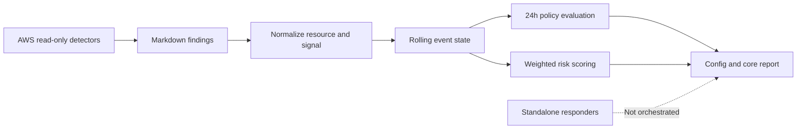

# SynAccel Sentinel

**Phase 2 research prototype** · Explainable AWS exposure monitoring and risk prioritization

Sentinel explores how cloud findings can become useful operational context: detect a misconfiguration, identify the affected resource, combine related signals, and explain why an issue deserves attention. It is a research framework, not a production security product or an autonomous remediation service.

## Project Status

Phase 1's rolling response-policy loop remains available. Phase 2 adds per-resource weighted risk scores with signal-level explanations and time decay. Both operate on local detector reports and JSON state.

Implemented today:
- Read-only IAM checks for users without MFA and access keys older than 90 days.
- S3 checks for public ACLs, bucket policies, and incomplete Public Access Block settings.
- A rolling 24-hour event counter and configurable Phase-1 policy escalation.
- Phase-2 risk aggregation by affected user or bucket, with configurable weights, bands, and half-life.
- Markdown core reports and an offline `unittest` regression suite.



## Risk Model

Each distinct signal contributes a configurable weight to its resource. Older findings decay exponentially; scores are capped at 100. Duplicate ingestion of the same signal for the same resource does not increase its score.

```text
contribution = weight * 2 ** (-age_hours / half_life_hours)
resource_score = min(round(sum(distinct signal contributions)), 100)
```

Default signal weights in [`configs/sentinel_config.json`](configs/sentinel_config.json):

| Signal | Weight |
| --- | ---: |
| IAM user without MFA | 35 |
| IAM access key older than 90 days | 25 |
| Public S3 bucket policy | 65 |
| Public S3 ACL | 60 |
| S3 ACL open to authenticated AWS accounts | 45 |
| Missing or incomplete S3 Public Access Block | 35 |

| Score | Level | Core recommendation |
| ---: | --- | --- |
| 0–24 | Low | Monitor |
| 25–49 | Guarded | Review and confirm ownership |
| 50–74 | High | Prioritize manual triage |
| 75–100 | Critical | Escalate for human review |

Scores are prioritization signals, not a probability of compromise or a substitute for security review. A single high-impact S3 policy finding can outrank several lower-impact IAM hygiene findings; the report lists each contributing signal and its decayed points.

## Quick Start

Use Python 3.9+ and install the AWS SDK dependency:

```bash
python -m pip install -r requirements.txt
```

Configure the AWS CLI profile `sentinel-automation` with the read-only permissions needed for IAM and S3 inventory and inspection. Run the detectors first, then the core:

```bash
python src/detectors/s3_public_access_detector.py
python src/detectors/iam_exposure_detector.py
python src/core/sentinel_core.py
```

Detector and core reports are written under `reports/sample_output/` (ignored by Git). The core reads reports modified within the last 24 hours, updates the policy and event state, computes risk scores from the configured 48-hour window, and writes a timestamped report. The 24-hour counter window and scoring lookback/half-life are separate settings.

Run the AWS-independent tests without credentials:

```bash
python -m unittest discover -s tests -v
```

## Configuration and Boundaries

- [`configs/sentinel_config.json`](configs/sentinel_config.json) stores policy thresholds and risk weights/bands.
- [`state/sentinel_state.json`](state/sentinel_state.json) stores event history, counters, and the latest scores.
- The core does not make AWS calls. It does not use a risk score to trigger remediation.
- Responders are standalone scripts, not connected to the core. The S3 responder can change bucket Public Access Block settings and tags; the IAM responder tags users. Review these scripts and their permissions before use.
- Report ingestion currently parses the detector Markdown format. JSON findings, durable storage, event provenance, and multi-account identity are future improvements.

## Repository Layout

```text
configs/       Policy thresholds and Phase-2 scoring configuration
docs/          Phase-1 showcase and project visuals
src/core/      Event rollup, policy adaptation, scoring, and reports
src/detectors/ Read-only IAM and S3 exposure checks
src/responders/Standalone IAM tagging and S3 remediation actions
state/         Rolling local event state
tests/         Offline core regression tests
```

The [Phase-1 showcase](docs/showcase_phase1_arl.md) documents the original adaptive loop. The current Phase-2 scoring implementation and its tests are the source of truth for scoring behavior.

## Next Milestones

1. Replace phrase-based Markdown ingestion with a versioned finding schema and JSONL replay fixtures.
2. Add confidence, asset criticality, and ownership context as separate score dimensions rather than hiding them in signal weights.
3. Add a replay/simulation command that produces comparable reports without AWS credentials or changing live config/state.
4. Design a policy-aware response workflow with dry-run, explicit approval, idempotency, and an audit log before connecting responders.
5. Add CloudTrail/GuardDuty signals only after the event contract and scoring calibration are established.


